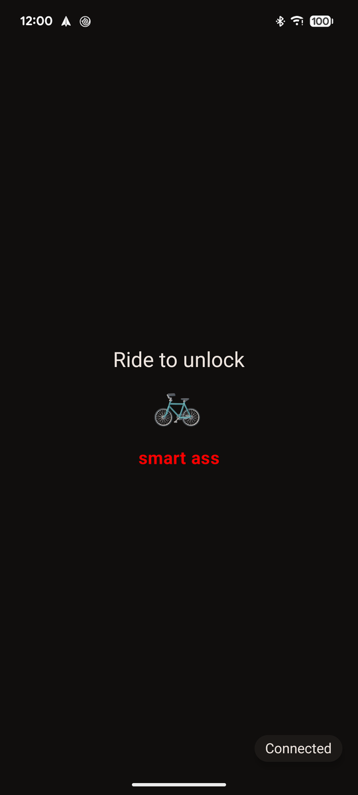
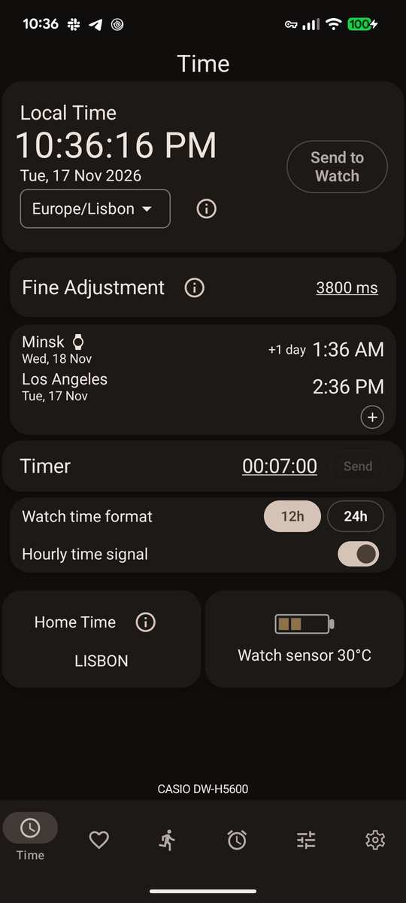
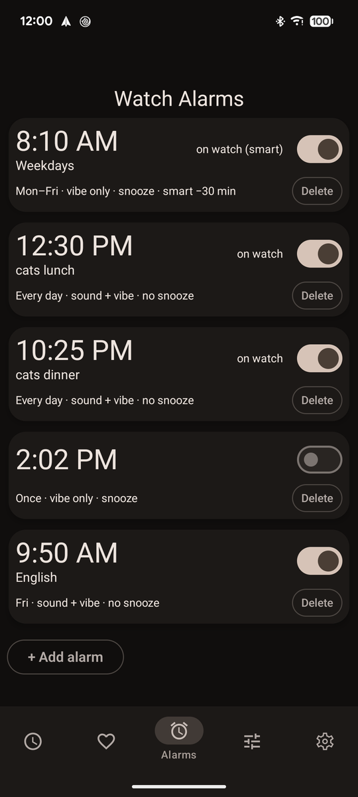
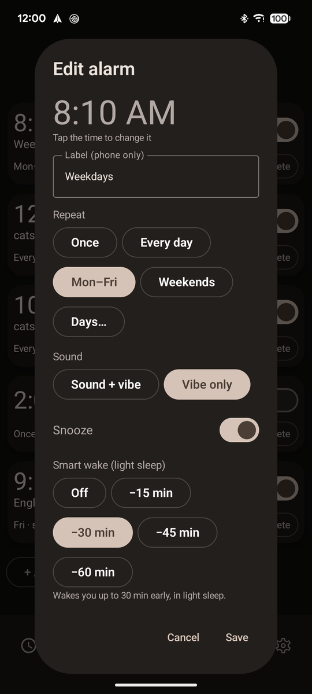
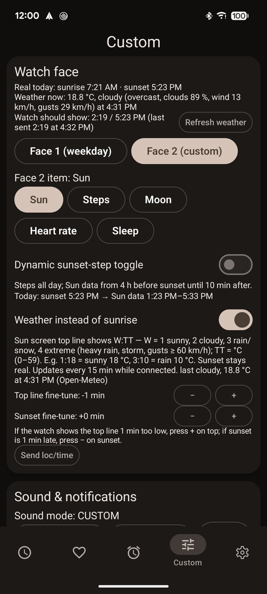
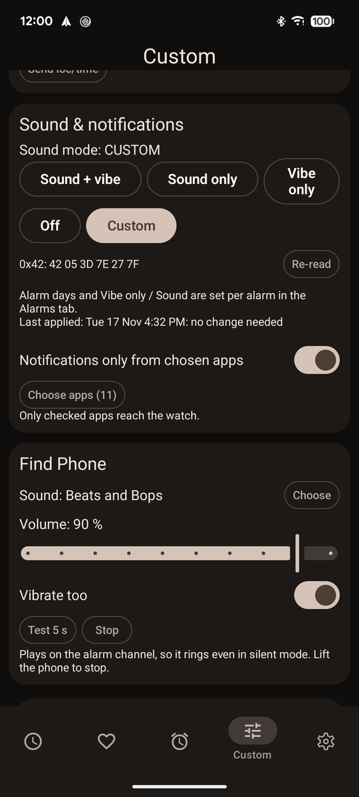
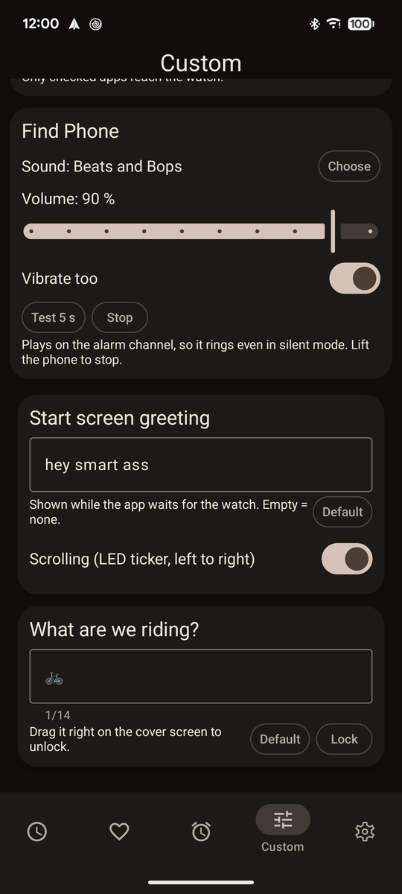
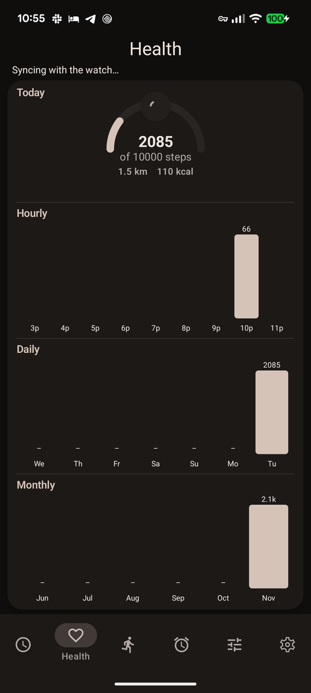
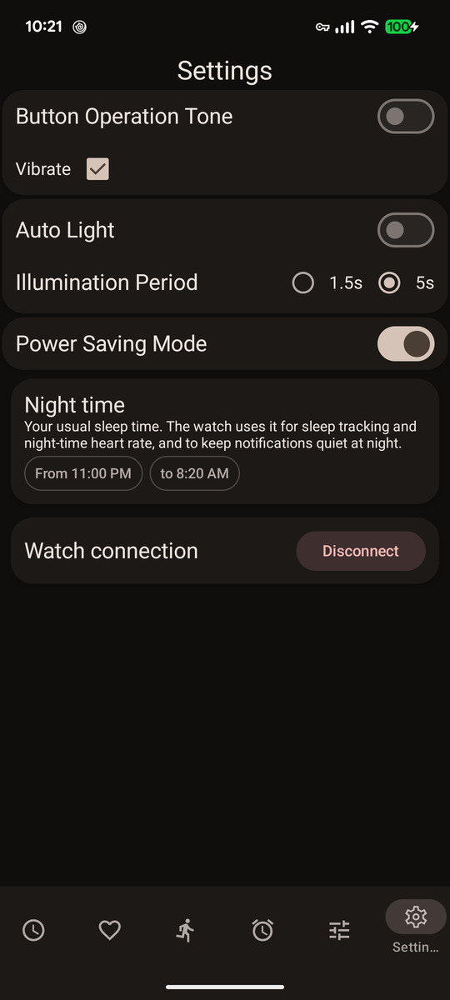
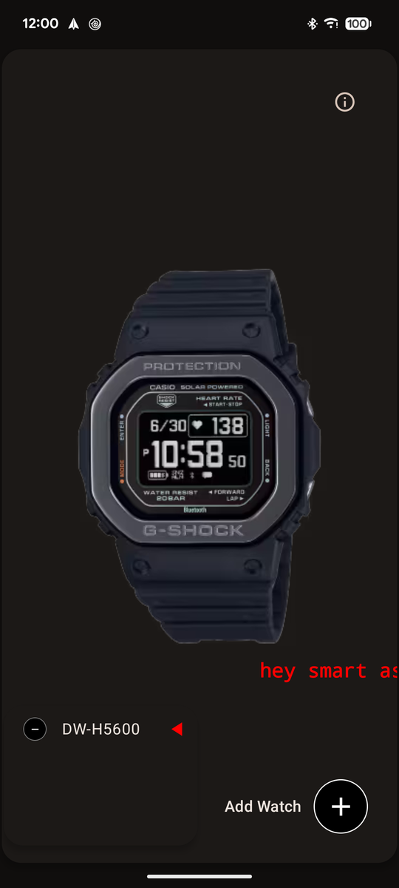

# GShock Smart Ass

**Arthur Dent's unofficial fork of [G-Shock Smart Sync](https://github.com/izivkov/CasioGShockSmartSync), built specifically for the Casio G-SHOCK DW-H5600.**

The upstream app talks to dozens of Casio watches. This fork talks to one, and goes much further with it: it treats the DW-H5600 as an always-connected companion and moves into the phone everything the watch cannot do on its own — unlimited alarms, per-alarm sound and days, a snooze the phone can stop, a watch face that follows the sunset, the weather on the sun screen, and step history.

It is not affiliated with Casio or with the upstream project. It has only been tested with one DW-H5600 (module 3516) on one Pixel; other watches will connect but get none of the extras.

<p align="center">
  
  
  
</p>

---

## What it does

### Alarms — as many as you like


The DW-H5600 has four alarm slots and one smart-alarm slot. This app keeps an unlimited list on the phone and loads the alarms due in the next 24 hours into the watch, swapping them as they ring (cards marked *on watch*).

Each alarm has:

- a **label** (phone only — the watch has no alarm names)
- **repeat**: *Once*, every day, Mon–Fri, weekends or any set of days
- **Sound + vibe** or **Vibe only** — the watch's single sound mode is switched for the alarm that is due next
- **snooze** on/off
- **smart wake**: ring up to 15/30/45/60 minutes early, in light sleep

A **one-time** alarm switches itself off after it has rung (and finished snoozing), and is set again for its next time when you switch it back on.

Hold an alarm and drag it to reorder the list; new alarms go to the top. Edits show instantly on the phone and reach the watch in the background (merged and queued, retried if the watch does not answer).

<br clear="right">



**One editor for everything.** Tap *+ Add alarm* or any alarm card; all options are set before anything is sent, so the watch gets a single update.

**Snooze you can stop from the phone.** The watch does not tell the phone whether an alarm is snoozing, so after an alarm with snooze rings the phone shows a *may be snoozing — Stop snooze* notification (and a button on the card). Stopping cancels the snooze on the watch. The app also avoids its own time syncs and alarm rewrites during a snooze window — both cancel a running snooze on the watch.

<br clear="left">

### Custom — the DW-H5600's own features

<p align="center">
  
  
  
</p>

- **Watch face** — Face 1 (weekday) or Face 2 with its item: Sun, Steps, Moon, Heart rate, Sleep.
- **Smart weather-step face** — Steps all day, the sun (or weather) screen before sunset; see below.
- **Weather instead of sunrise** — the weather and temperature on the watch's sun screen; see below.
- **Real today** — real sunrise and sunset, the current weather, and what the watch should be showing.
- **Sound mode** — Sound + vibe, Sound only, Vibe only, Off, Custom.
- **Notifications only from chosen apps** — a per-app allowlist for what reaches the watch.
- **Find Phone** — pick the ring sound and volume, vibrate too, test it. Pressing Find Phone on the watch rings the phone at once (the watch stays connected, so there is no reconnect wait); pressing *back* on the watch stops it.
- **Start screen greeting** and **What are we riding?** — see *The fun bits* below.

#### Weather instead of sunrise

The DW-H5600 has no weather, but it has a sun screen: sunrise on top, sunset below, both calculated by the watch from the home location it is given. This feature gives it a location chosen so that the "sunrise" reads as the current weather, while the sunset stays the real one.

The top line reads **`W:TT`**:

| `W` | weather |
|---|---|
| 1 | sunny — clear, or clouds up to 30 % |
| 2 | cloudy — overcast, fog |
| 3 | rain or snow — any precipitation |
| 4 | extreme — heavy rain or snow, thunderstorm, more than 2 mm in 15 minutes, wind from 40 km/h or gusts from 60 km/h |

`TT` is the outdoor temperature in °C. So `1:18` is sunny and 18 °C, `3:07` is rain and 7 °C.

- The current conditions come from [Open-Meteo](https://open-meteo.com) for the phone's location. They are fetched just after every quarter hour, when Open-Meteo publishes new values, and sent to the watch while it is connected.
- How it works: the app solves for a latitude and longitude where today's sunrise falls at `W:TT` local time and the sunset falls at the real sunset where you are. It uses the same horizon angle the watch's own formula appears to use, measured against the watch, so the display lands on the right minute. If your watch is still a minute off, use the *Top line* and *Sunset* fine-tune buttons.
- The watch only recalculates its sun times when its time is set, so each update is a location write plus a time sync. Updates pause while an alarm may be snoozing, because a time sync would cancel the snooze.
- Limits: temperatures below 0 °C show as `00`, and above 59 °C as `59`. The real sunrise is no longer shown (the *Real today* card in the app still shows it). With no connection or no internet, the watch keeps the last weather it received.

#### Smart weather-step face

Face 2 shows one item at a time. With this switch on (*Dynamic sunset-step toggle* in the app), the phone picks the item for you:

- **Steps** for most of the day;
- the **sun screen** from **four hours before sunset until ten minutes after** (the lead time is adjustable in 15-minute steps, from 15 minutes to 12 hours) — with *Weather instead of sunrise* on, that is the weather and temperature on top and today's sunset below.

The app works out today's sunset from the phone's location and switches the face exactly at both edges with an exact Android alarm, so it also happens when the phone is asleep. While the switch is on, the manual item buttons are greyed out. During polar day or night (no sunset), the face stays on Steps.

### Time


- **Fine Adjustment** — the offset applied whenever the watch's time is set.
- **Extra clocks**, as many as you like, each with its date: *+ Add clock*, tap one to rename it, change its time zone (searchable list of cities) or delete it. They live on the phone; the watch's own world time is not touched.
- **Timer**.
- **Watch time format** 12h / 24h — the whole app follows the watch.
- **Hourly time signal**.
- **Home time** and the **watch sensor** temperature (it reads body heat, not the weather).
- **Battery** as the watch shows it: four bars. The watch reports a level, not a percentage; tap the battery to tell the app how many bars the watch shows for the current level.

<br clear="right">

### Health



Steps from the watch's LifeLog: today's total, the goal, distance, calories and an hourly breakdown.

A full LifeLog transfer takes a few minutes — the watch sends its history in small pieces and keeps answering "busy" — so the app saves the last result on the phone and shows today's numbers immediately, with *Synced at …*, while a new sync runs in the background. Pull down to sync now.

<br clear="left">

### Settings



Button tone and vibration, auto light, illumination period, power saving — each change is written to the watch straight away (no *Send* button), on top of a fresh read so nothing else on the watch is touched.

**Disconnect** drops the connection after a confirmation; the watch reconnects the usual way (its connect button).

<br clear="right">

### The fun bits

<p align="center">
  
  
  
</p>

- **Start screen greeting** — shown while the app waits for the watch, optionally as a stepping LED ticker. Tap *Connected* on the cover to see it. Change the text and switch the ticker on at the bottom of the Custom tab.
- **Ride to unlock.** The app opens on a cover screen: drag the ride sideways to get in. It accelerates past your finger; pulled left it spins (faster the further you pull) and, released, launches off the right edge before the app opens.
- **What are we riding?** — any text up to 14 characters, emoji welcome. 🚲 by default. Set it at the bottom of the Custom tab.
- **Pull up to lock** — on any tab already at the bottom, keep pulling up: a lock appears above the tab bar, release to lock. Or use the *Lock* button.
- The app reopens on the tab you used last, and stays upright (portrait only).

---

## Under the hood

The watch stays connected all day (the app repeats the official app's `0x39` handshake), and a scheduler on the phone does the watch's planning:

- when an alarm time passes: reload the alarm slots, the smart slot and the sound mode, switch finished one-time alarms off
- at the edges of the sunset window: switch the watch face
- every quarter hour: refresh the sun data or the weather (a location and time sync — the watch only recalculates its sun times on a time write)
- on every connection: one location and time sync

It wakes itself with exact Android alarms, so this keeps working while the phone dozes overnight. Requests to the watch are shared between screens, retried when the watch does not answer and serialized per setting, so two quick changes cannot undo each other.

The protocol details found along the way (sound mode `0x42`, watch face `0x51`, smart alarm `0x50`, home location `0x24`, battery level, LifeLog, …) are written up in the [GShockAPI fork](https://github.com/flyboy14/GShockAPI/tree/h5600-sound-mode) in `docs/DW-H5600-protocol.md`. More notes for this app: [`docs/DW-H5600.md`](docs/DW-H5600.md).

## Building and installing

There is no release build; build it yourself. The app compiles against the GShockAPI fork from source, so clone both side by side:

```
git clone -b h5600-sound-mode https://github.com/flyboy14/GShockAPI.git
git clone -b h5600-sound-mode https://github.com/flyboy14/GShockSmartass.git
cd GShockSmartass
./gradlew testGithubDebugUnitTest assembleGithubDebug     # JDK 21, Android SDK 37
adb install -r app/build/outputs/apk/github/debug/app-github-debug.apk
```

Android 8 or later. **Switching from the official CASIO WATCHES app:** unpair on the watch (SETTING → GENERAL SETTINGS → PAIRING → UNPAIRING), forget the watch in Android's Bluetooth settings, then pair it in this app. Only one app can own the watch at a time.

## Known limits

- The watch's alarm slots ring every day; the phone is what switches day-specific and one-time alarms on and off. If the watch is away from the phone for more than a day, they ring on the wrong days until it reconnects.
- The watch does not report snooze state, so *may be snoozing* is the phone's best guess (a 40-minute window after an alarm with snooze).
- Battery bars beyond the levels you have calibrated are estimates.
- Stopwatch laps cannot be read: the watch sends nothing about its stopwatch.

## Credits and license

Built on [G-Shock Smart Sync](https://github.com/izivkov/CasioGShockSmartSync) and [GShockAPI](https://github.com/izivkov/GShockAPI) by Ivo Zivkov — all the hard work of talking to Casio watches is theirs. Weather data by [Open-Meteo](https://open-meteo.com).

Apache License 2.0, like the upstream project — see [LICENSE](LICENSE).
